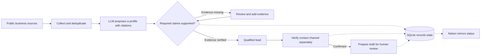

# B2B Outreach Agent

**An evidence-first AI workflow for cross-border B2B sales**

Built by Janty · AI Product & Agent Workflows · [中文版](README.zh-CN.md)

In cross-border lighting sales, a model can call a company a strong prospect before it can show where the company operates, what it sells, or whether the business can actually be reached. I built a Python workflow that keeps those questions separate and gives a salesperson a concrete next step for each candidate.

## How it works



- **Evidence before promotion.** The model proposes claims and citations. The workflow checks the citations against collected source material and keeps incomplete candidates available for review.
- **Separate contact and delivery states.** A published business number, a verified WhatsApp channel, and a prepared message each have their own status. The salesperson reviews the draft and decides whether to send.
- **One source of truth.** SQLite records decisions and status changes. Notion gives the salesperson a view of what is ready and what needs attention.

## What I built and verified

I translated the sales qualification criteria into review states, built the workflow in Python, and used supervised runs to diagnose gaps between model output and business evidence.

| Scenario | Observed outcome |
| --- | --- |
| A Spanish-language site described a wholesale business, but the captured material did not establish its country of operation. | I held the candidate for review. After adding direct evidence from the website, I rechecked the existing model output and advanced the candidate without another model call. |
| The public contact channel was verified in a supervised run. | A WhatsApp draft was entered and retained for human review. I read back the draft status from Notion. No message was sent during that validation. |

The live checks used targeted scripts and human supervision. Reliability of the unified entry point and commercial impact remain unverified.

## Try the offline demo

```bash
python3 demo.py
```

Two fictional candidates start with the same model score. One stays in review because a claimed fact is missing from the cited source. The other advances on verified evidence, then waits for a separately confirmed channel before a draft can be prepared.

The demo uses the Python 3.8+ standard library and an in-memory database. This repository contains the case study and a standalone simulation with fictional data.

I’m looking for AI product and agent workflow roles where I can work from a real business problem through prototyping and validation. If you’re building AI-native tools for operators, I’d like to hear what you’re working on.
