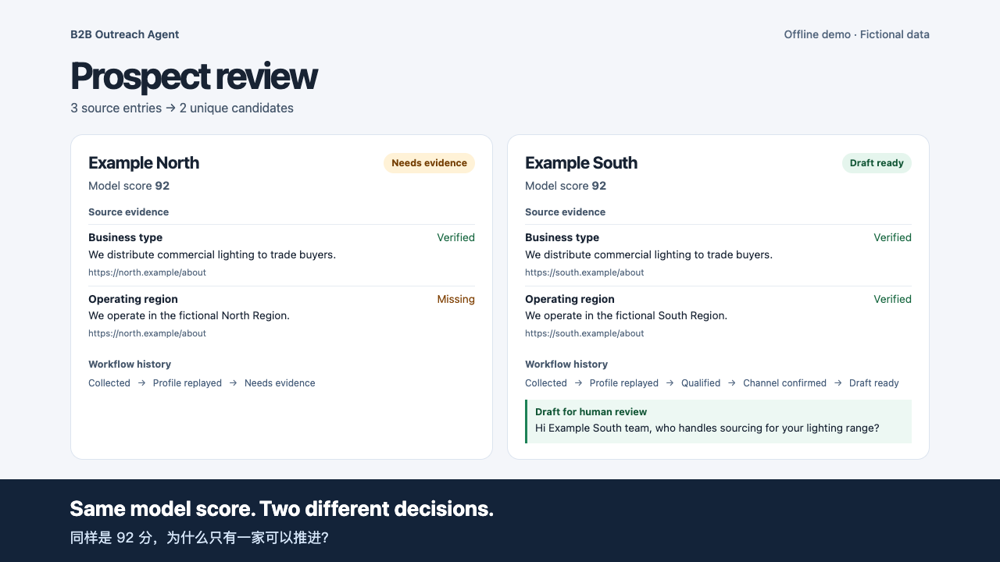

# 跨境 B2B 拓客 Agent

**让每条客户判断有来源，让销售知道下一步该做什么。**

Janty · AI 产品与 Agent 工作流 · [English](README.md)

在跨境照明拓客里，模型可能把一家企业判为高潜客户，但销售还需要知道它在哪里经营、是否做批发，以及公开的联系方式能否实际使用。我把这些业务判断做成了 Python 工作流里的证据校验与状态流转。

[](docs/demo.mp4)

[60 秒演示 · 中英双语字幕](docs/demo.mp4)

## 我怎么设计原型

1. **采集与去重。** 归并来自公开渠道的企业候选，保留来源。
2. **模型提议，证据校验。** LLM 生成画像与引文，系统对照来源。关键信息缺失时，候选进入待复核。
3. **资格与触达分开。** 企业符合目标、公开号码有出处、WhatsApp 可用、草稿已输入，各自记录。是否发送由销售决定。
4. **记录与业务界面分开。** SQLite 保存状态与依据，Notion 镜像业务状态，方便查看缺什么、下一步由谁处理。

## 实测中的一次取舍

一家西语照明企业的官网可以证明它做批发，但最初采集的内容没有说明经营国家。我把它留在待复核，补到官网的经营地证据后，复用原模型输出重新校验，完成资格晋升，没有再调用一次模型。

在受监督的真实平台验收中，我核验了 WhatsApp 渠道，录入草稿并保留给人工审核，也从 Notion 读回了草稿状态。该验收发送量为 0。现场使用定向脚本和人工监督，统一入口的稳定性与商业成效尚未验证。

## 一键运行展示版

```bash
python3 demo.py
```

打开生成的 `demo-output/index.html`。程序从三条虚构网页记录归并出两家企业，回放同为 92 分的模型画像。

| 候选 | 证据核验 | 渠道状态 | 最终状态 |
| --- | --- | --- | --- |
| Example North | 指定来源没有经营地引文 | 跳过核验 | 待补证据 |
| Example South | 指定来源包含两条必需引文 | 模拟确认 | 草稿待人工审核 |

本地看板从 `demo-output/ledger.sqlite3` 读回状态、引文和草稿。再次运行会刷新快照，也可以用 `--output ./another-folder` 把本次结果保存到其他目录。

展示版仅需 Python 3.8+ 标准库，依次运行[本地网页读取和去重](outreach_demo/source.py)、[画像回放与证据核验](outreach_demo/workflow.py)、[SQLite 状态入库](outreach_demo/ledger.py)和[本地看板生成](outreach_demo/board.py)。模型画像与渠道核验结果来自[预置场景](fixtures/scenario.json)。原型的真实平台验收使用 Notion 状态镜像与 WhatsApp 人工监督草稿。

我在找 AI 产品与 Agent 工作流方向的机会，尤其希望加入能从真实业务问题出发、快速做原型并到现场验证的团队。
